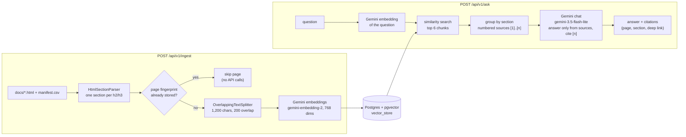

# spring-docs-rag

[](https://github.com/shambhavishashi15/spring-docs-rag/actions/workflows/ci.yml)

A Retrieval-Augmented Generation (RAG) service that answers questions about Spring using 15 Spring Boot and Spring Framework documentation pages. Answers are grounded only in retrieved chunks and cite their sources (page + section); when the docs don't contain the answer, the service says so instead of guessing. Built with Java 21, Spring Boot 4, Spring AI 2, pgvector and Google Gemini.

**Status:** milestone 4 (quality and delivery) — code complete; the eval score is pending its first live run.

## Architecture



- **Ingestion** (`ingestion` package) turns each Antora docs page into sections (page intro, every h2 and h3), splits long sections into overlapping chunks, prefixes each chunk with "page title > section", and stores it with its citation metadata (page title, section, deep-link URL).
- **Embeddings** (`embedding` package) use Gemini's native API through Spring AI's Google GenAI starter, with retry and batch-size settings tuned for the free tier.
- **Answering** (`ask` package) retrieves the closest chunks, numbers them by section, and asks Gemini (through its OpenAI-compatible endpoint) to answer only from those sources with `[n]` markers; the cited numbers are mapped back to page + section.
- **Errors** (`web` package) are returned as RFC 9457 `ProblemDetail` JSON by a `@RestControllerAdvice`.

## Quick start

Prerequisites: Java 21 (the Maven wrapper downloads Maven itself), Docker, and a Google Gemini API key from [Google AI Studio](https://aistudio.google.com/apikey); the free tier is enough.

1. Download the Spring docs pages listed in `docs/manifest.csv`:

   ```bash
   scripts/fetch-docs.sh
   ```

2. Start Postgres with the pgvector extension:

   ```bash
   docker compose up -d
   ```

3. Set your API key (it is read from the environment and never stored in the repo) and start the app:

   ```bash
   export GEMINI_API_KEY=your-key
   ./mvnw spring-boot:run
   ```

4. Ingest the docs (parse, chunk, embed, store in pgvector):

   ```bash
   curl -X POST localhost:8080/api/v1/ingest
   ```

   It returns a summary such as `{"pagesIngested":15,"pagesSkipped":0,"chunksStored":448}`. A first run on the free tier can take a few minutes because the per-minute embedding quota is waited out with exponential backoff; if the daily quota is used up, the call fails fast with a 429 instead.

5. Ask a question:

   ```bash
   curl -s localhost:8080/api/v1/ask -H 'Content-Type: application/json' \
     -d '{"question": "How do I activate a Spring profile?"}'
   ```

   Or try the API in Swagger UI at <http://localhost:8080/swagger-ui.html>.

## API

| Endpoint | Purpose |
|---|---|
| `POST /api/v1/ingest` | Ingests the pages in `docs/manifest.csv`; unchanged pages are skipped. Returns `{pagesIngested, pagesSkipped, chunksStored}`. |
| `POST /api/v1/ask` | Body `{"question": "..."}` (required, at most 1,000 characters). Returns `{answer, answered, citations: [{id, page, section, url}]}`; each citation `id` matches an `[n]` marker in the answer, and `answered` is `false` when the docs don't contain the answer. |
| `POST /api/v1/chat` | Plain Gemini chat without retrieval (milestone 1's smoke test). |
| `/swagger-ui.html`, `/v3/api-docs` | Swagger UI and the OpenAPI spec. |

Errors are `ProblemDetail` JSON: 400 for invalid requests (with an `errors` map of field → message), 429 when Gemini's quota or rate limit is exhausted (with `Retry-After` when Gemini gives a wait), and 500 with a generic message for anything unexpected.

## Idempotent ingestion

Each page gets a SHA-256 fingerprint of its parsed sections plus the ingestion settings (chunk size, overlap, embedding model and dimensions), stored in every chunk's metadata. On a re-run, unchanged pages are skipped without any API calls, and changed pages have all their chunks replaced in one transaction, so there are never duplicates or stale chunks.

## Design decisions and trade-offs

The full reasoning for each milestone is in [`plans/`](plans).

| Decision | Why | Trade-off / alternative |
|---|---|---|
| Spring Boot 4.1 + Spring AI 2.0 | The latest stable Spring AI release only supports Boot 4. | Newer APIs (Jackson 3, Spring Framework 7) with fewer examples online. |
| Chat through Gemini's OpenAI-compatible endpoint, embeddings through Spring AI's Google GenAI starter | Spring AI 2's OpenAI SDK rejects Gemini's OpenAI-compatible embedding responses (the first item has no `index`). Both use the same API key. | Two client libraries instead of one; `spring.ai.model.embedding: none` keeps exactly one `EmbeddingModel` bean. |
| Chat model `gemini-3.5-flash-lite` | Its free tier allows 500 requests per day and 15 per minute; `gemini-3.8-flash` allows only 20 per day and 5 per minute, fewer than one 20-question eval run. Answers only need to restate retrieved text, which a Lite model handles. | A smaller model than 3.8 Flash; `GEMINI_CHAT_MODEL` switches models without a code change. |
| 768-dimension embeddings | pgvector's HNSW index supports at most 2,000 dimensions; 768 is one of Gemini's recommended sizes. | Slightly less precise than the default 3,072. |
| Chunks never cross an h2/h3 section, split by our own `OverlappingTextSplitter` | Citations need page + section; Spring AI's `TokenTextSplitter` has no overlap. Breaks at paragraph, line, sentence, then word. | Characters, not tokens: easy to explain and well under the embedding input limit, but chunk token counts vary. |
| Idempotency through a per-page fingerprint | Unchanged pages cost no API calls; a changed page is replaced in one transaction, so a failed embedding call leaves the old chunks in place. | Splitter code changes aren't captured by the fingerprint (clear the table instead). Deterministic chunk IDs with upsert would re-embed everything each run and leave stale tail chunks. |
| Retry configured on the Google SDK, not Spring AI | Spring AI's `RetryTemplate` never sees the SDK's exceptions; the SDK's own retry is the layer that runs. 8 attempts, 5s doubling to 60s, which outlasts the free tier's per-minute window. | Retries are silent (the SDK doesn't log them). |
| Fail fast on long waits | Gemini's daily-quota 429 says "retry in 8h" in its JSON body (`RetryInfo`), which the SDK ignores. An OkHttp network interceptor reads it and throws `EmbeddingQuotaExceededException` (→ HTTP 429 with `Retry-After`) instead of retrying for minutes. | Depends on the body format of Gemini's errors; a 429 without `RetryInfo` falls back to the normal backoff. |
| Embedding batches capped at 100 | Gemini rejects larger batches; PgVectorStore's default batching limits tokens, not items. | A small extra `BatchingStrategy`. |
| Own `AskService` instead of Spring AI's `QuestionAnswerAdvisor` | The prompt and the source numbering are explicit, so citations map exactly to sections. | About 100 lines of our own code. |
| Inline `[n]` citations parsed with a regex | Readable answers, and no JSON parsing failure mode. | Relies on the model following the format; the eval measures it. |
| Fixed "not in the docs" sentence | An explicit, testable refusal (`answered: false`). With no retrieved chunks the LLM isn't called at all. | Detection is an exact sentence match. |
| Similarity threshold 0 (accept all), top 6 | A guessed threshold could silently drop relevant chunks; the eval will give data to tune it. | Weakly related chunks can reach the prompt; the prompt rules keep the answer grounded. |
| `ProblemDetail` through `ResponseEntityExceptionHandler` | The base class already covers Spring MVC's exceptions; we add field errors, 429s and a safe 500. | — |
| Tests never call Gemini | Mocked `ChatModel` and `EmbeddingModel`; the embedding mock returns deterministic bag-of-words vectors, so integration tests against real pgvector (Testcontainers) still retrieve meaningfully. | Answer quality can only be measured by the live eval. |
| Eval by key facts, expected page and refusal | Three signals show whether a failure comes from retrieval, generation or grounding. Key facts are identifiers checked by substring. | An LLM judge would grade paraphrases but costs quota and is non-deterministic. |

## Testing

```bash
./mvnw verify
```

Runs unit tests (HTML parser, splitter, batching, retry interceptor, Gemini error details, `AskService`, controller and error handling, eval runner resume) and integration tests that start the whole app against pgvector in Testcontainers (needs Docker). The Gemini models are always mocked, so no API key or quota is needed. A local fake server also verifies the real Google SDK client: a long `RetryInfo` stops after one request, a short one keeps retrying.

## Evaluation

`eval/questions.json` holds 20 questions: 18 answerable ones covering all 15 pages, each with an expected page and key facts that appear verbatim on it, and 2 the docs don't answer (OAuth2 login, Kafka listener concurrency). With the app running and the docs ingested:

```bash
./mvnw test -Dtest=EvalRunner -Deval.baseUrl=http://localhost:8080
```

It calls `/api/v1/ask` for each question (pausing between them for the free tier, `-Deval.delay=6` for 6 seconds), writes `eval/report.md` and prints the scores. Each result is saved to `eval/results.json` as soon as it arrives, so a run stopped by a quota resumes where it left off; add `-Deval.fresh=true` to start over (always after changing the prompt or retrieval settings). A question passes when the answer contains all key facts, cites the expected page, and is answered or refused as expected.

| Metric | Score |
|---|---|
| Questions passed | _pending first run_ |
| Key facts found (answerable questions) | _pending first run_ |
| Expected page cited (answerable questions) | _pending first run_ |
| Correct refusal behaviour | _pending first run_ |

## Docker

```bash
docker build -t spring-docs-rag .
docker run --rm --network host -e GEMINI_API_KEY -v "$PWD/docs:/app/docs:ro" spring-docs-rag
```

The image is built in two stages (JDK to build, JRE to run), uses Spring Boot's layered jar so dependency layers stay cached, and runs as a non-root user. `--network host` lets the container reach the Compose Postgres on `localhost:5432` (on Docker Desktop, enable host networking or set `DB_URL` to `jdbc:postgresql://host.docker.internal:5432/springdocsrag`). The docs are mounted, not baked in, because they aren't redistributed.

## CI

[GitHub Actions](.github/workflows/ci.yml) runs `./mvnw verify` and builds the Docker image on every push and pull request to `main`. Testcontainers uses the runner's Docker, and no secrets are needed because tests never call Gemini.

## Configuration

Everything is in `src/main/resources/application.yml` and can be overridden with environment variables: `GEMINI_API_KEY` (required), `GEMINI_CHAT_MODEL` (default `gemini-3.5-flash-lite`), `GEMINI_EMBEDDING_MODEL` (default `gemini-embedding-2`), `DB_URL`, `DB_USERNAME`, `DB_PASSWORD`, `DOCS_DIR`, and any other property through Spring Boot's relaxed binding (e.g. `APP_ASK_TOPK` for `app.ask.top-k`).

## Spring documentation

The docs HTML is not redistributed in this repository: the pages are "Copyright Broadcom. All Rights Reserved.", so only their URLs (`docs/manifest.csv`) are committed and `scripts/fetch-docs.sh` downloads them from [docs.spring.io](https://docs.spring.io).
